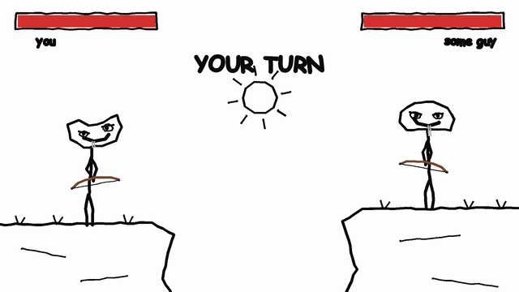

<div align="center">

# Bonk Bow

**Stickman archery played by idiots. They have bows. That's about it.**

A turn-based 3D archery duel for Android, built on Solana Mobile.
Your wallet is your account, every duel has a small SOL entry fee, and the
shop takes SOL or SKR.




<sub>The house style, from the launch video. The game draws its archers the same way, in 3D.</sub>

</div>

---

## The game

Two scrawled stickmen stand on facing cliffs and take turns trying to shoot
each other. The joke is the gap between the two halves of the game:

- **The duel underneath is a real one.** Drag back like a slingshot, read the
  dotted arc, release. Fixed-step physics, head / body / leg hit zones,
  100 HP, a shot clock, sudden death, and an AI opponent that gets sharper as
  you do.
- **The archers on top are useless.** They hold the bow backwards, eat the
  arrows, fire straight up and get bonked by their own shot, celebrate before
  anything lands, and notice they've been hit a moment late. They are
  completely confident the whole time.

Deadpan, dumb, never mean. Winning feels like an accident you get to take
credit for.

### Features

- **3D duels against an adaptive AI.** Its aim tightens with your lifetime hit
  rate (`enemyNoise` in `src/game3d/world.ts`). It runs offline and instantly,
  with no LLM.
- **Comedy that never changes a result.** Early cheers, wrong-way draws,
  arrow snacks and the self-bonk are presentation only. The fixed-step sim
  decides every hit the same way, and nothing you buy changes a shot.
- **Hand-drawn look.** Every head, face and hat is a set of drawing
  instructions (`src/game/derps.ts`), rendered as wobbly ink that redraws
  itself a few times a second, so the app looks like the videos.
- **Progression.** XP, levels, coins per match, a daily bonus, a day streak and
  a local best-runs board.
- **A shop for idiots.** Characters, hats, outfits, bows, arrows and three 3D
  maps. Some items are sold for SOL or SKR, newer ones for coins earned by
  playing.
- **The wallet is the account.** One Mobile Wallet Adapter sheet (Phantom,
  Solflare, or Seed Vault on Seeker) connects it. Every payment is signed in
  the wallet and read back from the chain before anything unlocks.
- **No backend.** Everything the app keeps lives on the phone; the only
  network calls go to the wallet and the Solana RPC.
- **Fits any Android screen.** Small phones, 21:9 and tablets, at any system
  font size (`src/ui/responsive.ts`, `src/ui/Text.tsx`).

### The cast

Every archer has the same stick body, a different scrawled head and one
stupid habit. Everyone does every bit now and then; his habit just comes up a
lot more.

| Archer | Habit | How to get him |
|---|---|---|
| **Gary** | Accuracy: no. Confidence: yes. Celebrates early. | Free |
| **Tall Steve** | Neck: too much. Shoots straight up a lot. | SOL / SKR |
| **Doug** | Eats the arrows. | SOL / SKR |
| **Kevin** | Faces the wrong way. Committed to it. | SOL / SKR |
| **Some Guy** | 847 wins. Visibly bored. The usual opponent. | SOL / SKR |
| **Bob** | Has never held a bow. Holding one now. | Coins |
| **Lil Timmy** | Tiny head. Big bow. Same arrows. | Coins |
| **Carl** | Snacks between rounds. Snacks during them. | Coins |
| **Chad** | Celebrates every shot. Hits some. | Coins |

On top go **hats** (top hat, traffic cone, viking helmet, a fish, an arrow
through the head, and more; they do not help), **outfits** (scarf, office tie,
hero cape, tutu, gold suit…), **arrows** (fire, neon, pencil, plunger…) and
**bows**, including the **Shovel Bow**: someone in the comments asked for it,
so we added it. The maps are **Classic** (free), **Elder Forest**,
**Windmill Valley** and **Snowfall Village**.

## How the Solana parts work

| | |
|---|---|
| **Sign-in** | `useWalletAuth()` (`src/solana/auth.ts`) is a Mobile Wallet Adapter connect / disconnect. The provider caches the auth token, so later launches reconnect silently. There is no session and no server. |
| **Duel entry fee** | Every duel costs `DUEL_FEE_LAMPORTS` (0.01 SOL) to the treasury, paid on the match screen. The paid entry becomes a ticket for that match's seed, and `/game` refuses to start a duel without one, deep links included. A fee that went out but wasn't used (app killed, slow confirmation) is kept as a credit for the next duel. |
| **Shop payments** | One transaction from the wallet to the treasury: a System Program transfer (SOL), or an idempotent create-ATA plus a `TransferChecked` pinned to the SKR mint and 6 decimals. Each carries an SPL memo `bonkbow:<item id>`. The app reads the transaction back (`getTransaction`, confirmed) and checks status, memo, payer, treasury and amount against the catalogue before storing the item. |
| **Restore** | An interrupted check is kept as a pending purchase and retried when the shop opens. On a new install, `restorePurchasesFromChain` rebuilds ownership from the wallet's `bonkbow:` memos (shop open, or Settings → Restore purchases). |
| **SKR** | Every real-money item has an SKR price (about 20% under SOL). The shop remembers "pay in SKR" and shows the live balance from the wallet's token account. The mainnet mint is `SKRbvo6Gf7GondiT3BbTfuRDPqLWei4j2Qy2NPGZhW3`; on devnet set any 6-decimal test mint. |

The trade-off: purchase checks run in the client. The items are cosmetic, so a
patched client only fools itself.

## Tech stack

- **App:** Expo SDK 57, React Native 0.86, Expo Router, TypeScript
- **3D:** three.js through `@react-three/fiber` on `expo-gl`, driven by one fixed-step simulation (`src/game3d/sim.ts`)
- **Solana:** `@wallet-ui/react-native-kit` (Mobile Wallet Adapter), `@solana/kit`, SPL Token + Memo
- **State:** zustand persisted to AsyncStorage
- **Audio and feel:** `expo-audio` (CC0 music and SFX, per-screen crossfades), `expo-haptics`
- **Ops:** EAS Build and EAS Update, Sentry, PostHog

## Getting started

Mobile Wallet Adapter and the crypto polyfill are native modules, so **Expo Go
won't work**: use a development build.

```bash
npm install
cp .env.example .env.local     # optional: every value has a default
npm run android                # build + install the dev client on a device or emulator
npm start                      # Metro, once a dev build is installed
```

Or build the dev client in the cloud with `npm run build:dev`.

To test payments without a Seeker, use Phantom or Solflare on the device and
stay on devnet (the default). Airdrop yourself some devnet SOL to pay duel fees
and shop items.

Quality gates: `npm run typecheck`, `npm run lint`, `npm run doctor`.

### Configuration

All variables are optional (`.env.local` locally, EAS environment variables
for cloud builds).

| Variable | Default | What it does |
|---|---|---|
| `EXPO_PUBLIC_SOLANA_CLUSTER` | `devnet` | `devnet` or `mainnet-beta` |
| `EXPO_PUBLIC_SOLANA_RPC_URL` | public devnet RPC | Use a dedicated RPC on mainnet |
| `EXPO_PUBLIC_TREASURY_ADDRESS` | built-in (`src/solana/config.ts`) | Wallet that receives duel fees and shop payments |
| `EXPO_PUBLIC_SKR_MINT` | mainnet SKR on mainnet | A 6-decimal test mint for SKR on devnet |
| `EXPO_PUBLIC_SENTRY_DSN` | none | Crash reporting |
| `EXPO_PUBLIC_POSTHOG_KEY` | none | Product analytics (no session replay, no touch capture) |

## Project layout

```
src/app/            screens (Expo Router): menu, match (entry fee), game, result,
                    shop, style, best runs, settings
src/game/           data and rules: derps.ts (cast, hats, bows), gear.ts (outfits,
                    arrows), skins.ts / maps.ts (catalogue and prices),
                    progression.ts (XP, levels, coins), store.ts (persisted state)
src/game3d/         sim.ts + world.ts (physics, turns, hit zones, AI), Duel3D.tsx,
                    Arena.ts, Stickman3D.ts, DerpHead.ts + ink.ts (the scrawled heads),
                    Stage.tsx (menu sets), fitFov.ts
src/solana/         config.ts, auth.ts (MWA), payments.ts (fees, purchases, restore),
                    skr.ts, WalletButton.tsx
src/ui/             HUD, emotes, thumbnails, kit (buttons, bars), responsive.ts, Text.tsx
src/audio/          SFX pools, music crossfades, ducking
assets/audio/       CC0 music and SFX (see CREDITS.md)
site/               GitHub Pages: landing page, wallet-sheet icon, privacy, terms
scripts/            map optimiser, Unity export scripts
docs/               dev rules, assets, hackathon notes, submission checklist, videos
```

The Unity stickman and map packs are licensed Asset Store models, kept out of
the public repo (`assets/licensed/`, gitignored). Without them the app falls
back to a capsule body and procedural maps.

## Building and shipping

APKs for the Solana dApp Store are built with EAS from a local checkout,
`npm run build:apk` or `bunx eas-cli workflow:run build-android.yml`. Never
build from a GitHub push: a fresh checkout doesn't have the licensed models,
and `.easignore` keeps them in a local upload. Publishing uses the
`dapp-store` CLI (`npm run publish:dapp-store`). The full steps (release key,
Publisher Portal, mainnet switch) are in
[docs/SUBMISSION.md](docs/SUBMISSION.md) and the
[Solana Mobile publishing docs](https://docs.solanamobile.com/dapp-store/publishing-cli).

On every pull request, a GitHub Action publishes the change as an EAS Update
and comments a QR code to load it in a development build.

## Status

Built for **CLOCK IN**, the Solana Mobile hackathon. Before a mainnet release:

- Prices and the 0.01 SOL duel fee are placeholders.
- Payments haven't had a live end-to-end run with a real wallet yet.
- The app runs on devnet by default.

What's done and what's left: [docs/SUBMISSION.md](docs/SUBMISSION.md).

## Docs

| | |
|---|---|
| [DEV_RULES.md](docs/DEV_RULES.md) | Rules for working on this repo: device testing, 3D performance, game logic, screens and fonts, payments |
| [PIVOT.md](docs/PIVOT.md) | Why the game became Bonk Bow, and the cast and videos |
| [ASSETS.md](docs/ASSETS.md) | Where every asset comes from and how to rebuild the licensed ones |
| [HACKATHON.md](docs/HACKATHON.md) | CLOCK IN rules and judging |
| [SUBMISSION.md](docs/SUBMISSION.md) | Submission checklist, demo script, release steps |
| [docs/trailer/](docs/trailer/) | The launch videos, drawn entirely in code |

## Credits

Music and sound effects are CC0, from Kenney, OpenGameArt contributors, and
sounds made for this project (full list in
[assets/audio/CREDITS.md](assets/audio/CREDITS.md)). The fonts are Fredoka.
The stick body is the Unity Asset Store "Free Pack - Stick Man" by PolyOne
Studio, shipped in the APK but not in this repo.
